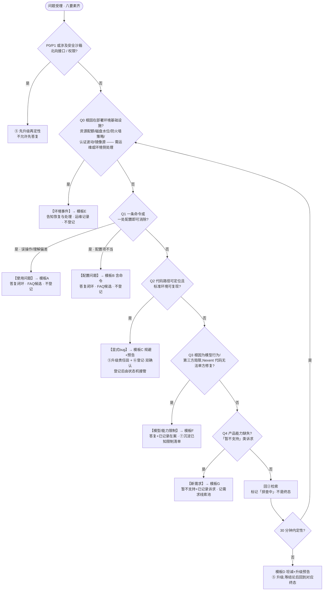

# Nexent 支撑问题定性规范 v2

> 版本:v2.0 ｜ 制定:2026-10-12 ｜ 依据:43 条真实反馈定性实战(见附录 A)
> 适用:Nexent 项目支撑全流程的「定性」环节(流程第③步)
> 同步义务:本规范变更时,必须同步更新 `nexent-support` skill(SKILL.md ③④⑦节 + templates.md)、《Nexent支撑流程指导书》第三章、《支撑工作流与自动化设计》L1/L5 层,四处口径保持一致。

---

## 1. 版本说明:v2 相对 v1(三问判定树)的三个变更

1. **拆掉「不确定/非显式bug」垃圾桶**。v1 里"FAQ 依据不足→不确定"、实战中自发出现的"非显式bug"混装了五种本质不同的东西:环境波动、资源/网络限制、模型行为局限、按设计如此、以及**尚未定位的问题**。前三者是终态结论,最后一个是流程状态——混在一起的结果是待定位问题掉进垃圾桶没人捞(实测 43 条中 3 条如此)。
2. **「排查中」是状态,不是终态**。任何问题必须最终落入 §3 路由表中的一个终态;「排查中」意味着回到检索流程并受 30 分钟时限约束,超时走升级。
3. **分类必须带路由**。v1 只回答"是什么",v2 同时回答"然后做什么":每个终态绑定话术模板、是否登记、去向、沉淀动作(§3)。

## 2. 判定树 v2

### 2.1 流程图



### 2.2 判定序列(文字版,供复制/检索)

依次问,**前一问命中即停**:

- **兜底门禁(先于一切)**:P0/P1 优先级、涉及安全沙箱/北向接口/权限的问题,无论多像使用问题,**先升级再定性**。
- **Q0** 根因是否在部署环境基础设施(资源配额、磁盘水位、防火墙/网络策略、认证波动、镜像源),且处理动作主要由运维/环境侧执行?→ 是 →【环境事件】
- **Q1** 一条命令或一处配置即可消除?→ 误操作/理解偏差 →【使用问题】;配置项不当 →【配置问题】
- **Q2** 代码路径可定位且标准环境可复现?→ 是 →【显式bug】
- **Q3** 根因为模型行为/第三方依赖局限,Nexent 代码无法单方修复?→ 是 →【模型/能力限制】
- **Q4** 是否产品能力缺失("暂不支持"类诉求)?→ 是 →【新需求】
- **全否** → 回②检索,标记「排查中」;30 分钟内无法定性 → 模板D 答复 + 立即升级⑤;升级结论回来后落对应终态。

定性结论必须给**依据**(哪条 FAQ / 哪段代码 / 哪次环境核查),不允许无依据断言。

### 2.3 与 v1 的兼容关系

| v1 | v2 |
|----|----|
| Q1 使用/配置问题 | 拆为【使用问题】【配置问题】两终态,新增 Q0 前置于它们 |
| Q2 真实bug | =【显式bug】 |
| Q3 FAQ依据是否高置信 | 其「是」分支并入 Q1~Q4 各终态;「否」分支不再作为分类,改为「排查中」状态 + 30 分钟定时升级 |
| (无) | 新增 Q3【模型/能力限制】、Q4【新需求】、Q0【环境事件】 |
| 模板 A/B/C/D | 全部保留;D 收窄为「排查中超时升级」专用;新增 E/F/G |

## 3. 终态定义与路由表

| 终态 | 判定要点 | 话术 | 进问题跟踪表? | 去向 | 沉淀动作 |
|------|---------|------|--------------|------|---------|
| 使用问题 | 误操作/理解偏差,正确操作即消 | A | 否 | 答复闭环 | FAQ 候选 |
| 配置问题 | 配置项/部署参数不当,含命令可消 | B | 否 | 答复闭环 | FAQ 候选 |
| 环境事件 | 资源/网络/波动类,需运维或环境侧处理 | E | 否 | 运维记录;跨团队事项(防火墙等)走申请流程 | 运维值班记录 + FAQ 候选 |
| 显式bug | 代码可定位、标准环境可复现 | C | **是(双确认)** | ⑤升级责任田,登记后由状态机接管;**支撑随即评估修复难度(§8),随个人跟踪表落档** | 闭环后沉淀 FAQ |
| 模型/能力限制 | 模型行为/第三方局限,产品无法单方修复 | F | 否 | 答复闭环 | **「已知限制清单」必录** |
| 新需求 | 产品能力缺失,客户有明确诉求 | G | 否(转需求池) | 需求线索池 → 评审 | 需求线索清单 |
| (排查中) | 以上均未命中——**状态而非终态** | (超时后 D) | 否 | 回②检索;30 分钟超时 → 升级 | — |

**登记纪律**:使用/配置/环境事件/模型限制一律**不进**问题跟踪表(非 bug);仅确认的显式bug 走双确认登记;新需求走需求池评审而非问题台账。答复含「暂不支持」字样的,无论终态为何,必须同时记一条需求线索(§7)。

## 4. 边界细则(43 条实战提炼)

1. **环境事件 vs 配置问题**:处理动作需要**基础设施变更**(扩配额、申请防火墙策略、等平台恢复、换镜像源)→ 环境事件;支撑/客户**一条命令或一处配置**即可消除(清磁盘、force-recreate、调 topK)→ 配置问题。示例:config 容器因资源不足反复重启=环境事件;ES 磁盘超水位清盘=配置问题。
2. **模型/能力限制 vs 显式bug**:缺陷在**产品对模型行为的处理**(报错不优雅、中断任务、读取逻辑不当)→ 显式bug(例:不支持深度思考输出时直接报错中断);模型自身局限且产品已合理处理(或无从处理)→ 模型/能力限制(例:模型按提示词格式生成 [a1][b1] 标签)。
3. **能力边界 vs 新需求**:答复是"设计如此/边界说明"且无扩优承诺 → 模型/能力限制(备注需求线索);客户诉求明确("能不能支持 X")→ 新需求。
4. **待定位禁止进终态**:处理记录只写了"可能是/疑似"的,一律「排查中」,限期定性;严禁为闭环而归入垃圾桶。

## 5. 话术模板 E / F / G(新增;模板 D 收窄)

### 模板 E · 环境事件
```
您好,您反馈的现象经核实为 <环境原因:资源不足/网络策略/平台升级波动> 所致,
不是系统功能缺陷。目前 <已恢复/处理方式:如扩容、策略申请进度>。
建议 <验证方式>。如再次出现请及时反馈,我们将同步环境侧跟进。
```

### 模板 F · 模型/能力限制
```
您好,经排查该现象源于 <模型/第三方组件> 的行为特性:<一句根因>,
当前版本产品侧的处理方式为 <现状说明/建议操作>。
我们已将此限制记录在「已知限制清单」,后续版本如有改进会同步告知您。
```

### 模板 G · 新需求(能力边界)
```
您好,您提到的 <能力> 目前版本暂不支持,理解您的诉求。
我们已将此记录为需求建议并提交评估,后续版本规划确定后会同步进展。
当前替代方案:<可用的临时做法>。
```

### 模板 D · 排查超时升级预告(收窄后语义)
仅用于「排查中」满 30 分钟无法定性时:坦诚告知已收到+正在升级至 <责任模块>+预计反馈时间。**不再**用于能力边界类答复(那类用 G)。

A/B/C 模板不变,见 `references/templates.md` 与《支撑流程指导书》。

## 6. 「已知限制清单」维护规则

- **定位**:FAQ 收录"**可解决的**"问题;已知限制清单收录"**解决不了但必须主动告知**"的模型/第三方局限与产品设计边界。两者互补,不重复收录。
- **触发时机**:问题定性为【模型/能力限制】或【新需求(边界确认型)】且答复闭环时,同批追加条目;定性为显式bug 的**不进**清单(走问题跟踪表)。
- **条目格式**:`现象 / 根因(模型特性或产品边界) / 当前解法或替代方案 / 记录日期 / 来源(局点+日期) / 关联问题单(如有)`。
- **文件**:`D:\projects\feishu\Nexent已知限制清单.md`,按域分组(模型兼容与输出解析、北向能力、前端交互、沙箱执行、部署形态)。

## 7. 需求线索池

- **来源**:凡答复话术含「暂不支持」的定性(新需求终态本体,或使用/配置答复中附带的能力诉求)。
- **机制**:轻量起步——在本文件附录 B 维护线索清单(编号/诉求/来源/日期),**每月**汇总评审一次,通过的转入需求池表正式立项。
- 实测 43 条中 6 条含需求信号(#11、#18、#30、#34、#42、#43),v1 流程下这些信号随答复流失。

---

## 8. 修复难度分级与跟进联动（2026-10-20 新增）

> 与 P0~P3 优先级相互独立：**优先级决定响应速度，难度决定修复路径与周期**。两者分别记录、组合使用。

### 8.1 分级（三级 + 待评估）

| 档位 | 判定要点 |
|------|---------|
| 易 | 单点改动、标准环境可复现、无外部依赖——责任人本迭代可修 |
| 中 | 跨模块改动、需联调/数据兼容处理 |
| 难 | 需模型侧/第三方/环境侧/前端配合、根因未完全定位、架构级改动 |
| 待评估 | 默认态；升级结论回来或代码定位完成后 30 分钟内补评 |

### 8.2 评估四问（仅支撑评估，依次问、可定档即停）

1. **改动面**：单点修复还是跨模块？（改动文件/模块数是现成信号——代码定位时可数）
2. **外部依赖**：是否需要模型侧/第三方/环境侧/前端配合？
3. **规避现状**：已有可用规避方案不降低难度，只降低紧迫处理压力；
4. **复现确定性**：必现按前三问定档；概率性/依赖特定数据上调一档。

评估主体：**仅支撑**（定性为显式 bug 或升级项时，基于代码定位评估）；升级消息初判行附带难度供负责人参考，不强制回填。

### 8.3 记录位置

《现网问题个人跟踪表》新增 **F 列「修复难度」**（取值：待评估/易/中/难）；列结构 A-E 不变，历史行不回填，新行起生效。写入走 `table-write.mjs --op sheet-append`（6 列），随周期同步批量推送飞书。

### 8.4 跟进联动（难度 × 优先级）

| 组合 | 跟进策略 |
|------|---------|
| P0/P1 + 难 | 专项跟踪：每日过账、阻塞项上报管理层、必要时拆任务 |
| P0/P1 + 易/中 | 常规跟进：进晨报「在修清单」（P0/P1 全量 + 已停留天数老化） |
| P2/P3 + 难 | 建议转需求池或挂起，注明难度理由 |
| 其余 | 按既有 24h 回访 / 30 分钟定性纪律 |

### 8.5 度量

晨报/周报按难度分布统计修复周期（实现随 L4 度量层，见《支撑工作流与自动化设计》）。

---

## 附录 A:43 条反馈 v2 重分明表

> 对账:使用 8 + 配置 11 + 环境 5 + 显式bug 8 + 模型限制 5 + 新需求 3 + 排查中 3 = **43 条,无遗漏**。
> (注:2026-10-12 首次四分类时口称「42 条」为统计口误,实际 43 条。)

| # | 反馈 | v1 四分类 | v2 终态 | 判定要点 |
|---|------|----------|---------|---------|
| 1 | 天舟知识库生产→beta迁移 | 指南 | 配置问题 | 许可信息配置操作序列 |
| 2 | 部署问题咨询 | 指南 | 使用问题 | 离线部署操作指引 |
| 3 | 对话数据流缓慢 | 指南 | 配置问题 | 调 topK/rerank(FAQ#10) |
| 4 | 更改 AIDP key 部署失败 | 指南 | 配置问题 | force-recreate(FAQ#7) |
| 5 | 模型配置建议错位 | 显式bug | 显式bug | 提供商适配缺陷,待修 |
| 6 | API 下载 skill 文档 | 指南 | 使用问题 | 接口用法说明 |
| 7 | data-process 镜像失效 | 指南 | 配置问题 | 换离线部署形态 |
| 8 | 华为账号无 Email | 显式bug | 显式bug | 空邮箱兼容缺陷,修复已入码 |
| 9 | config 容器反复启动失败 | 指南 | **环境事件** | 资源不足需扩配额(基础设施变更) |
| 10 | 单次输出上限致中断 | 显式bug | 显式bug | 已修复待部署 |
| 11 | 子智能体提示词无法覆盖 | 新需求 | 新需求 | 提示词分层管理立项 |
| 12 | 沙箱长任务失活 | 非显式 | **排查中** | 记录仅"可能",限期定性 |
| 13 | 查询标签 [a1][b1][c1] | 非显式 | 模型/能力限制 | 模型按提示词格式生成,已录清单 |
| 14 | 回答验证报错 | 显式bug | 显式bug | think 标签校验待修正 |
| 15 | 空白 agent 串提示词 | 显式bug | 显式bug | app_config 残留,已修复(FAQ#11) |
| 16 | 60 体验环境认证失效 | 非显式 | **环境事件** | 升级波动,自愈类 |
| 17 | 知识库创建失败/不显示 | 指南 | 配置问题 | ES 水位线清盘(FAQ#9),命令可消 |
| 18 | MCP 失败致整会话失败 | 非显式 | 模型/能力限制 | 设计取舍=边界说明,录清单+需求线索 |
| 19 | monitoring 端口咨询 | 指南 | 使用问题 | 6006,信息告知 |
| 20 | 知识库跨环境迁移 | 指南 | 配置问题 | 同 AIDP 数据库为前提 |
| 21 | 部署失败路径错误 | 指南 | 配置问题 | 清残留+换离线包 |
| 22 | 本地 MCP 接入 | 指南 | **环境事件** | 防火墙策略,跨团队申请 |
| 23 | 复杂问数空输出 | 显式bug | 显式bug | 不支持深度思考却报错中断=产品处理缺陷;规避:关闭深度思考 |
| 24 | 子智能体执行失败 | 非显式 | 模型/能力限制 | 模型偏离代码格式约束 |
| 25 | nl2agent/skill 失败 | 指南 | 配置问题 | 未配默认模型 |
| 26 | 天舟北向无法访问 | 指南 | **环境事件** | 防火墙策略申请 |
| 27 | agent 仓库刷新缓慢 | 非显式 | **排查中** | 无处理记录,待定位 |
| 28 | 认证服务失效 | 非显式 | **环境事件** | 环境波动刷新解决 |
| 29 | 返回配置页报 fail to update | 非显式 | **排查中** | 无处理记录,疑似 bug 待定性 |
| 30 | 知识库北向接口范围 | 非显式 | **新需求** | 暂不支持他机构→诉求明确,转线索 |
| 31 | format_safety_validation | 指南 | 配置问题 | 运行策略开关(v2.6.0+) |
| 32 | 前端格式约束咨询 | 指南 | 配置问题 | 约束策略配置说明 |
| 33 | 天舟登录注册 | 指南 | 使用问题 | 规范输入+邀请码 |
| 34 | 版本备份回退 | 指南 | 使用问题 | 备份文档指引;脚本回退→需求线索 |
| 35 | 登录密码 | 指南 | 使用问题 | 无初始密码 |
| 36 | 北向接口字段 | 指南 | 使用问题 | 标题限 100 字符,规范告知 |
| 37 | run agent error | 指南 | 配置问题 | 设默认模型 |
| 38 | 非复杂任务输出截断 | 非显式 | 模型/能力限制 | 模型侧,交叉验证;录清单 |
| 39 | 概率性输出为空 | 非显式 | 模型/能力限制 | DeepSeek parser 分流;录清单 |
| 40 | 北向占用抖动卡死 | 显式bug | 显式bug | 线程池已实现于新版本 |
| 41 | MCP 多工具刷新久/搜不到 | 显式bug | 显式bug | 连通检测性能+列表丢失,待修 |
| 42 | 对话追加模式 | 新需求 | 新需求 | 暂不支持,诉求明确 |
| 43 | 北向 chat 身份注入 | 指南 | 使用问题 | 现状方案说明;服务端注入→需求线索 |

## 附录 B:需求线索池(月度评审)

| 线索编号 | 诉求 | 来源 | 日期 | 状态 |
|---------|------|------|------|------|
| XQ-001 | 子智能体系统提示词分层管理 | #11 | 2026-10-12 | 待评审 |
| XQ-002 | MCP 连接失败不影响整会话(容错隔离) | #18 | 2026-10-12 | 待评审 |
| XQ-003 | 知识库北向接口开放范围扩大 | #30 | 2026-10-12 | 待评审 |
| XQ-004 | 版本脚本化自动回退 | #34 | 2026-10-12 | 待评审 |
| XQ-005 | 对话追加模式 | #42 | 2026-10-12 | 待评审 |
| XQ-006 | 北向 chat 身份信息服务端注入 | #43 | 2026-10-12 | 待评审 |
| XQ-007 | API 转 MCP 工具支持 ssl_verify 可配置(每服务关闭开关;可选证书路径三态) | 问题单 reczz28PBZtFl3en(天舟数据湖,SSL 自签证书) | 2026-10-19 | 待评审 |
| XQ-008 | A2A 子智能体支持图片/文件（FilePart/DataPart）接收与回传；当前仅透传文本 | 万佳提问(2026-10-26,内网A2A取图) | 2026-10-26 | 待评审 |
| XQ-009 | A2A调用参数配置化:外部A2A智能体超时/流式开关/重试策略/连接复用/运行时metadata限额当前硬编码,需per-agent+全局两级可配(含运行时流式接线) | 天舟数据湖v2.6.1(梅子阳,A2A流式咨询延伸;问题跟踪表已登记,修改人万鸣晨) | 2026-10-27 | 待评审 |
